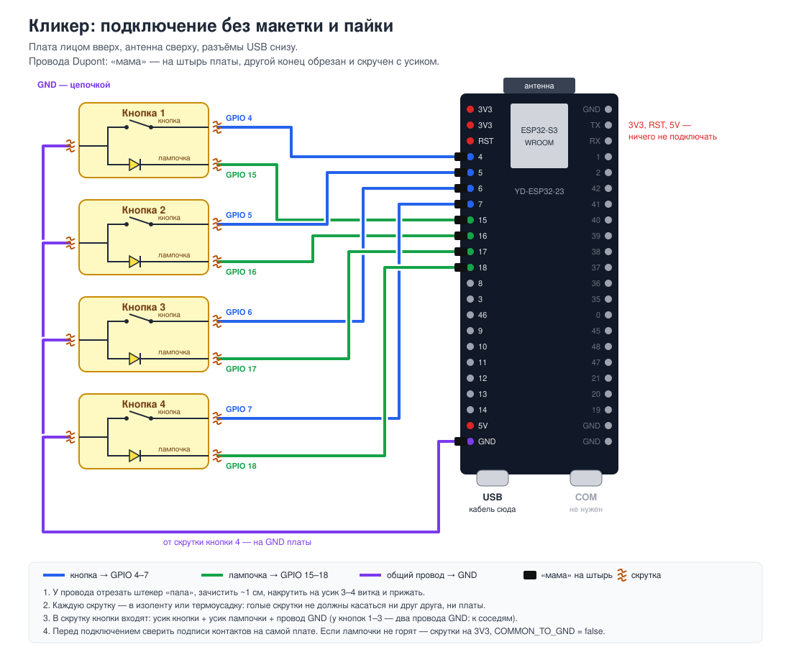

# Кликер

Четыре кнопки Kailh Box из брелока → левая кнопка мыши. Плата ESP32-S3 работает USB-мышью (драйверы не нужны),
у нажатой кнопки горит её светодиод. Записка проекта — история, решения, что дальше — в хранилище:
`life/projects/clicker/README.md`.



## Состав

| путь | что |
|---|---|
| `click_buttons/click_buttons.ino` | прошивка: кнопки GPIO 4–7, лампочки GPIO 15–18, общий провод на GND |
| `click_buttons/flash.sh` | сборка и заливка через `arduino-cli` |
| `pin_probe/pin_probe.ino` | проверка проводки: раз в 100 мс печатает уровни кнопок, мигает лампочками, мышью не кликает |
| `wiring.svg` | схема подключения скрутками, без макетки и пайки |

## Плата

YD-ESP32-23 2022-V1.3 (VCC-GND Studio), модуль ESP32-S3-WROOM-1 N16R8. Два USB-C: **USB** — родной USB чипа
(мышь, заливка, отладка), **COM** — через CH340. COM после перегрузки 18.11 не связывается с чипом;
работаем только через USB и **никогда не подключаем оба разъёма сразу**.

## Подключение

| кнопка | свободный усик кнопки | свободный усик лампочки | скрутка (усик кнопки + усик лампочки) |
|---|---|---|---|
| 1 | GPIO 4 | GPIO 15 | GND |
| 2 | GPIO 5 | GPIO 16 | GND |
| 3 | GPIO 6 | GPIO 17 | GND |
| 4 | GPIO 7 | GPIO 18 | GND |

- Входы подтянуты к 3,3 В внутри чипа, нажатие замыкает вход на GND.
- Резисторов нет: выход лампочки в самом слабом режиме (`GPIO_DRIVE_CAP_0`, около 5 мА) ограничивает ток.
- Лампочки не горят, а клики есть — светодиоды развёрнуты: скрутки на 3V3 и `COMMON_TO_GND = false`.
- 3V3, RST и 5V ни к чему не подключать.

## Контакты платы

Плата лицом вверх, антенна сверху, разъёмы USB снизу; № — позиция штыря сверху вниз. На обороте подписи
зеркальные. «Свободен» — можно брать под новые кнопки и лампочки без оглядки.

| № | левый ряд | кликер / назначение | правый ряд | назначение |
|---|---|---|---|---|
| 1 | 3V3 | питание 3,3 В — **не подключать** | GND | земля |
| 2 | 3V3 | питание 3,3 В — **не подключать** | TX (43) | UART0 → CH340 (COM), не трогать |
| 3 | RST | сброс — **не подключать** | RX (44) | UART0 → CH340 (COM), не трогать |
| 4 | 4 | **кнопка 1** | 1 | свободен |
| 5 | 5 | **кнопка 2** | 2 | свободен |
| 6 | 6 | **кнопка 3** | 42 | свободен (JTAG MTMS) |
| 7 | 7 | **кнопка 4** | 41 | свободен (JTAG MTDI) |
| 8 | 15 | **лампочка 1** | 40 | свободен (JTAG MTDO) |
| 9 | 16 | **лампочка 2** | 39 | свободен (JTAG MTCK) |
| 10 | 17 | **лампочка 3** | 38 | свободен |
| 11 | 18 | **лампочка 4** | 37 | занят памятью PSRAM (N16R8) — не трогать |
| 12 | 8 | свободен | 36 | занят памятью PSRAM — не трогать |
| 13 | 3 | загрузочный (strapping) — лучше не брать | 35 | занят памятью PSRAM — не трогать |
| 14 | 46 | загрузочный — лучше не брать | 0 | кнопка BOOT, загрузочный — не брать |
| 15 | 9 | свободен | 45 | загрузочный (напряжение флеш) — не брать |
| 16 | 10 | свободен | 48 | RGB-светодиод платы |
| 17 | 11 | свободен | 47 | свободен |
| 18 | 12 | свободен | 21 | свободен |
| 19 | 13 | свободен | 20 | USB D+ — **не трогать**, на нём мышь |
| 20 | 14 | свободен | 19 | USB D− — **не трогать**, на нём мышь |
| 21 | 5V | питание 5 В от USB — **не подключать** | GND | земля |
| 22 | GND | **общий провод кнопок** | GND | земля |

Свободных для новых кнопок и лампочек — 17: 1, 2, 8–14, 21, 38–42, 47. Входы и выходы на них работают так же,
как на 4–7 и 15–18.

## Сборка и заливка

```bash
click_buttons/flash.sh                          # только собрать
click_buttons/flash.sh /dev/cu.usbmodem14101    # собрать и залить
```

1. Кабель в разъём **USB** платы, удерживая **BOOT**; отпустить.
2. `flash.sh` с портом из `ls /dev/cu.usbmodem*`.
3. Нажать **RST**. Через несколько секунд Mac видит `ESP32S3_DEV` — мышь и порт отладки.

Сборка: `esp32:esp32:esp32s3`, ядро 3.3.12, `USBMode=default` (TinyUSB), `CDCOnBoot=cdc`, `FlashSize=16M`.
Пробник заливается той же строкой `arduino-cli` из своей папки.

## Поведение

- Каждое новое нажатие — новый клик, даже если другая кнопка ещё зажата. Удержание — зажатая левая кнопка
  (перетаскивание).
- Дребезг — 5 мс (`DEBOUNCE_MS`).
- Порт отладки `/dev/cu.usbmodem…` печатает `button N down/up`, только пока порт открыт.

## Грабли

- Ряд макетки — цифра: внутри цифры соединены a–e и отдельно f–j. Провод кнопки и провод лампочки под одной
  цифрой — бесконечные клики (вход повторяет лампочку).
- Сразу после RST плата ещё не видна — проверять через несколько секунд.
